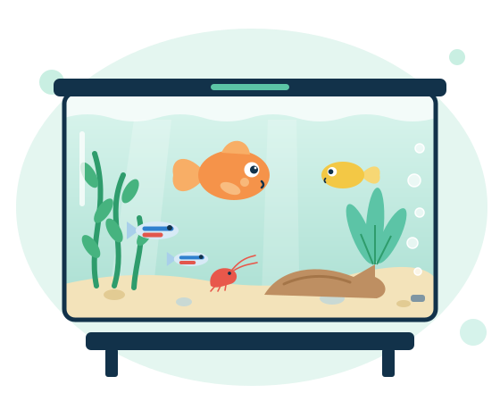
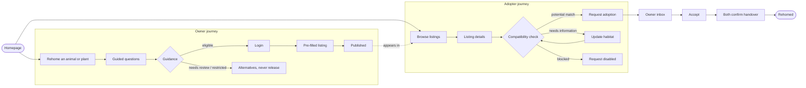
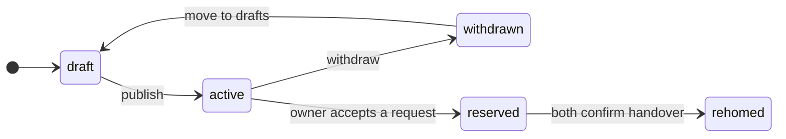
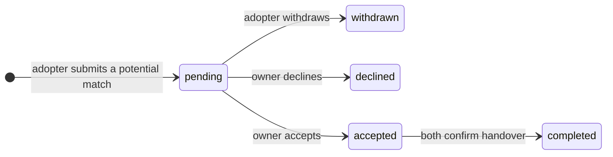
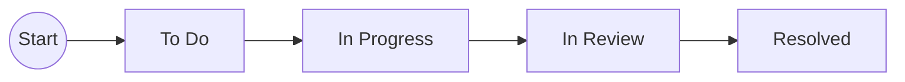

<p align="center">
  
</p>

<h1 align="center">AquaBridge</h1>

<p align="center">
  <b>Responsible rehoming for aquatic animals and plants.</b><br>
  CS2701 Group Project · Brunel University London · Group B14, Start-up 1 · UN SDG 14 Life Below Water
</p>

<p align="center">
  <a href="prototype/">Prototype</a> ·
  <a href="prototype/#demos">Demo flows</a> ·
  <a href="backlog/">Sprint 1 backlog</a> ·
  <a href="prototype/#design">Design system</a> ·
  <a href="https://dsouzashawn305.atlassian.net/jira/software/projects/KAN/boards">Jira (KAN)</a>
</p>

---

> [!NOTE]
> This repository holds the **Sprint 1 design reference**: a clickable front-end prototype with sample data, guided demo flows and the detailed backlog. It is the visual spec for the real app, not the app itself. Guidance and compatibility results are illustrative examples, **not** legal or biological advice.

## Contents

- [What AquaBridge does](#what-aquabridge-does)
- [Quick start](#quick-start)
- [What’s in this repo](#whats-in-this-repo)
- [Using the prototype](#using-the-prototype)
- [Demo flows](#demo-flows)
- [Design system](#design-system)
- [Shared data contracts](#shared-data-contracts)
- [Team and ownership](#team-and-ownership)
- [Jira workflow](#jira-workflow)
- [Updating the backlog](#updating-the-backlog)
- [Deploying to Vercel](#deploying-to-vercel)

---

## What AquaBridge does

Owners who can no longer care for fish, shrimp or aquatic plants get guided towards a responsible new home instead of releasing them. Adopters check that their tank or pond is suitable before they ask. Nothing is bought or sold.



---

## Quick start

No build step and no dependencies. It’s plain HTML, CSS and JavaScript.

| Option | How |
|---|---|
| Open directly | Double-click `index.html`, or open `prototype/index.html` in a browser |
| Local server | `npx serve .` then visit the address it prints |
| Python | `python -m http.server 8000` then visit http://localhost:8000 |

> [!TIP]
> Sample data and your clicks are saved in your browser. Use **Reset sample data** in the prototype footer to start fresh.

---

## What’s in this repo

```text
.
├── index.html                  Team hub: links to everything below
├── prototype/
│   └── index.html              The clickable prototype (all screens, demo flows, design system)
├── backlog/
│   └── index.html              Sprint 1 backlog page (generated, filter by person and week)
├── planning/
│   ├── sprint1-tasks.json      Source of truth: stories, epics, tickets, acceptance criteria
│   ├── backlog.template.html   Template for the backlog page
│   └── sprint1-jira-import.csv Jira CSV import (generated)
├── tools/
│   └── build.js                Rebuilds backlog/index.html and the CSV from the JSON
└── docs/assets/                Aquarium illustration and colour swatches used in this README
```

---

## Using the prototype

### The pages

| Area | Screens | Login needed |
|---|---|---|
| **Public** | Homepage · Browse listings · Listing details · Guided questionnaire · Review answers · Guidance outcome | No |
| **Rehoming** (account menu) | My Listings · Listing editor · Incoming requests | Yes |
| **Adopting** (account menu) | My Habitat · Compatibility check · Request adoption · My Requests | Yes |
| **Team tools** (footer) | Demo flows · Screen map · Design system | No |

### Things to know

| Feature | What it does |
|---|---|
| **Sample user** | Any login signs in as **Jordan Lee (U-01)**, who owns some listings and has sent some requests, so both sides of the product can be seen. |
| **Return after login** | Starting a guarded action while signed out (e.g. *Create my listing*) asks you to log in, then returns you to that action with your answers kept. |
| **Build notes strip** | The grey bar under the header names each screen’s owner, Sprint 1 task IDs and backlog stories. Toggle it from the footer. |
| **Demo controls** | Dashed amber boxes let you play the *other* person (e.g. “Owner accepts”). They exist only in the prototype. |
| **Reset sample data** | Footer link. Restores every listing, habitat and request. |
| **Direct links** | Add `#browse`, `#rehome`, `#demos`, `#map` or `#design` to the prototype URL to open that page. |

### Sample outcomes to try

| To see… | Do this |
|---|---|
| Eligible guidance | Rehome → Animal → **Neon tetra** → Healthy |
| Needs review | Rehome → Animal → **I’m not sure what it is** |
| Restricted | Rehome → Animal → **Red-eared slider** |
| Potential match | Neon tetras listing → Check compatibility → **Living room tropical tank** |
| Needs information | Java fern listing → **Bedroom nano tank** (pH missing) |
| Blocked | Pink hardy water lily → **Living room tropical tank** (pond only) |

---

## Demo flows

Open **Demo flows** from the prototype footer (or `prototype/#demos`). Each flow starts from fresh sample data. A guide panel says **who is acting**, **what they do**, **what happens behind the scenes** and **who builds it**. Press **Next step** and the prototype performs the action and highlights it. **Back** works at every step.

### Flow 1 · Owner rehomes six neon tetras (11 steps)

| # | Step | Actor | Owner |
|---|---|---|---|
| 1 | Start from the homepage, choose *Rehome* | Owner, signed out | Shared |
| 2 | Choose animal or plant | Owner, signed out | Farhan F-01, F-02 |
| 3 | Pick species (Neon tetra) and quantity | Owner, signed out | Farhan F-02, F-05 |
| 4 | Condition (healthy) and reason (moving) | Owner, signed out | Farhan F-02 |
| 5 | Town, postcode district and timing | Owner, signed out | Farhan F-02 |
| 6 | Review answers with *Change* links | Owner, signed out | Farhan F-03 |
| 7 | Guidance: **eligible**, intake `IC-301` | Owner, signed out | Farhan F-04 |
| 8 | Login checkpoint remembers the editor | Owner, signed out | Shared (mock login) |
| 9 | Listing editor, **pre-filled** from intake | Owner, signed in | Farhan F-06 → Shawn S-01 |
| 10 | Published: `L-1051` active in My Listings | Owner, signed in | Shawn S-01, S-04, S-05 |
| 11 | Visible in public Browse | Anyone | Shawn S-02 |

### Flow 2 · Adopter checks a habitat and requests Java fern (10 steps)

| # | Step | Actor | Owner |
|---|---|---|---|
| 1 | Browse without an account | Adopter, signed out | Shawn S-02 |
| 2 | Open the Java fern listing | Adopter, signed out | Shawn S-03 + Farhan F-05 |
| 3 | Login to use a saved habitat | Adopter, signed out | Shared (mock login) |
| 4 | Result: **needs information** (pH missing) | Adopter | Midhir M-03, M-04 |
| 5 | For comparison: **blocked** (lily vs indoor tank) | Adopter | Midhir M-04 |
| 6 | Edit the saved habitat, add pH 6.8 | Adopter | Midhir M-01, M-02 |
| 7 | Result: **potential match** | Adopter | Midhir M-03, M-04 |
| 8 | Write the request | Adopter | Midhir M-06 → Shawn S-08 |
| 9 | Request `R-512` pending in My Requests | Adopter | Midhir M-07 |
| 10 | Owner accepts; tracker appears | Owner → adopter | Shawn S-07 → Midhir M-07 |

### Flow 3 · Owner chooses an adopter and completes the handover (11 steps)

| # | Step | Actor | Owner |
|---|---|---|---|
| 1 | Two requests arrive for the goldfish | Owner | Shawn S-06 |
| 2 | Compare owner-safe habitat summaries | Owner | Midhir M-05 → Shawn S-06 |
| 3 | Decide: Accept or Decline | Owner | Shawn S-07 |
| 4 | Accepted: listing **reserved** | Owner | Shawn S-07, S-08 |
| 5 | Other request goes **on hold** | Owner | Shawn S-08 |
| 6 | My Listings shows reserved | Owner | Shawn S-04, S-05 |
| 7 | Owner confirms handover | Owner | Shawn S-10 |
| 8 | The adopter’s confirmation screen | Adopter | Midhir M-09 |
| 9 | Both confirmed: request **completed**, listing **rehomed** | System | Shawn S-08, S-10 |
| 10 | Gone from public browsing | Anyone | Shawn S-02 |
| 11 | Kept in the owner’s rehomed history | Owner | Shawn S-04 |

---

## Design system

**Coastal Trust**: light, calm and trustworthy. Deep ocean navy for text, ocean teal for actions, seafoam tints for supporting panels, coastal mist for the background. Light theme only.

### Colours

| | Name | Hex | Token | Use |
|---|---|---|---|---|
|  | Deep Ocean | `#12324A` | `--ink` | Headings, body text, SDG band |
|  | Ocean Teal | `#0B7A6E` | `--primary` | Primary buttons, links, selected states |
|  | Seafoam | `#5CC4A6` | `--weed` | Small highlights only (logo wave, markers) |
|  | Seafoam Tint | `#DDF3EC` | `--primary-soft` | Selected options, info panels |
|  | Coastal Mist | `#F4F8F7` | `--bg` | Page background |
|  | White | `#FFFFFF` | `--surface` | Cards, forms, panels |
|  | Shoreline | `#D3E3DE` | `--line` | Borders and dividers |
|  | Tide Grey | `#4E6677` | `--ink-2` | Secondary text, hints |

**Status colours** are separate from the brand and always come with a text label.

| | Name | Hex | Used for |
|---|---|---|---|
|  | Match | `#1F7A4D` | `active`, `completed`, `potential_match`, `eligible` |
|  | Caution | `#965A00` | `pending`, `reserved`, `needs_information`, `needs_review` |
|  | Stop | `#B4352C` | `declined`, `blocked`, `restricted`, errors |

**Specimen plates** (the coloured panel on each listing, coloured by habitat group):

|  |  |  |  |
|:-:|:-:|:-:|:-:|
| Tropical `#D6EFE9` | Coldwater `#DEE8F2` | Aquarium plant `#E0EFD9` | Pond plant `#EDEBD5` |

### Type

| Role | Font | Where |
|---|---|---|
| Display | **Familjen Grotesk** 500–700 | Headings, menu, card titles |
| Body | **Atkinson Hyperlegible** 400 / 700 | All reading text and forms. Designed by the Braille Institute for low-vision readers |
| Data | **IBM Plex Mono** 400 / 500 | IDs (`L-1045`), water readings (`20–26 °C`, `pH 6.0–7.0`, `≥ 54 L`), labels |

Scale: `13 · 15 · 16 · 20 · 26 · 34 · 52 px` · Corners: `6px` · Spacing: `4 · 8 · 12 · 16 · 24 · 32 · 48 · 72 px`

### Components

| Component | Notes |
|---|---|
| Buttons | Primary (teal), secondary (white + border), quiet (text), danger (red outline). Say exactly what happens: *Publish listing*, *Send request* |
| Status chip | One component for every contract status. Dot + text, never colour alone |
| Choice card | Radio styled as a card, used in the questionnaire and habitat form |
| Specimen plate | Scientific name in italic display type on a habitat-coloured panel, plus a fish or leaf line icon |
| Parameter strip | Mono readout of temperature, pH and minimum volume (detail page only, not on cards) |
| Range bar | Species range vs habitat value for temperature and pH on the compatibility page |
| Handover tracker | Accepted → Owner confirmed → Adopter confirmed → Rehoming complete |
| Toast and inline confirm | Short confirmations; destructive actions confirm inline, never with browser pop-ups |

### Rules we follow

| ✅ Do | ❌ Don’t |
|---|---|
| Use the specimen plate for listings | Stock photos or AI-generated fish art |
| Flat colour, one border style, 6px corners | Gradients, glows, heavy shadows |
| Two line icons (fish, leaf) and text labels | Emoji as icons |
| Real units in the mono face (°C, pH, L, cm) | Vanity stats or made-up numbers |
| Left-aligned content | Centring everything |
| Visible focus ring, 44px touch targets, one column under 900px | Hover-only interactions |
| Short listing cards: plate, title, *Animal · Town*, date, one tag | Care ranges, quantity or IDs on cards |

---

## Shared data contracts

| Entity | ID prefix | Owner |
|---|---|---|
| Species | `SP-` | Farhan |
| Intake (questionnaire outcome) | `IC-` | Farhan |
| Listing | `L-` | Shawn |
| Adoption request | `R-` | Shawn |
| Habitat profile | `H-` | Midhir |
| User | `U-` | Shared (university login) |

**Listing lifecycle** (Shawn)



**Adoption request lifecycle** (Shawn’s service, Midhir’s adopter screens)



| Outcome set | Values |
|---|---|
| Guidance (Farhan) | `eligible` · `needs_review` · `restricted` |
| Compatibility (Midhir) | `potential_match` · `needs_information` · `blocked` |

---

## Team and ownership

| Person | Role | Feature area | Sprint 1 tickets | Reading Week targets |
|---|---|---|:-:|:-:|
| **Shawn D’Souza** | Product Owner | Listings & Rehoming Management | 13 | 6 |
| **Muhammad Farhan Ul Haque** | Scrum Master | Guided Rehoming & Species Guidance | 10 | 5 |
| **Midhir Maru** | Developer | Habitat Matching & Adopter Experience | 12 | 6 |
| All three | | End-to-end demo run (SH-07) | 1 | |

**“50% by Reading Week”** means each person’s Reading Week target tickets are merged, their acceptance criteria are ticked in Jira, and they run in the shared app with sample data.

All 40 Deliverable 2 stories map to at least one ticket. See the coverage table at the bottom of the [backlog page](backlog/).

---

## Jira workflow

Project **KAN** · 6 epics (KAN-1 to KAN-6) · 39 tickets (KAN-7 to KAN-45)



| Status | Meaning | Category |
|---|---|---|
| **To Do** | Not started | To do (grey) |
| **In Progress** | Someone is building it | In progress (blue) |
| **In Review** | Pull request open, waiting for a teammate’s review | In progress (blue) |
| **Resolved** | Merged, acceptance criteria ticked | Done (green) |

Labels: `sprint-1` · `week-1` / `week-2` / `week-3` · `reading-week-target` · `owner-shawn` / `owner-farhan` / `owner-midhir` / `owner-all` · `deferred`

---

## Updating the backlog

`planning/sprint1-tasks.json` is the single source for the backlog page and the Jira CSV.

```bash
node tools/build.js
```

This rebuilds `backlog/index.html` and `planning/sprint1-jira-import.csv`. Edit the JSON, run the command and commit both outputs.

---

## Deploying to Vercel

The site is static, so it needs no framework, build command or settings.

1. Push this folder to GitHub.
2. In Vercel: **Add New → Project →** import the repository.
3. Framework preset **Other**, leave the build command empty, output directory `.` (the repo root).
4. Deploy. The root URL opens the team hub; `/prototype/` and `/backlog/` open the pages.

> [!IMPORTANT]
> A Vercel link is public to anyone who has it. The data is fictional, but turn on **Vercel Authentication / password protection** in the project settings if you want it private to the team.

---

<sub>Sprint 1 design reference for CS2701 · Sample data only · Illustrative guidance, not legal or veterinary advice.</sub>
